<p align="center"></p>

# AI Box

**One chat, a whole team.** You talk to one master [Claude Code](https://code.claude.com/docs) session; it splits the work and runs workers in parallel, each in its own repo, while you watch.

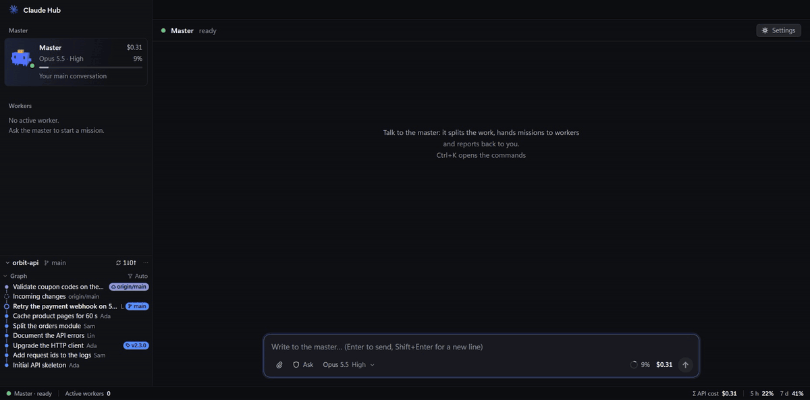

> **Unofficial project.** AI Box is not made, endorsed or supported by Anthropic. Claude and Claude Code are trademarks of Anthropic PBC. AI Box runs the Claude Code you install yourself and uses your own Claude access.

## What it does

### A master and its workers

Tell the master what you want. It writes a brief for each job, starts a worker in the right folder and sums up their reports for you. Workers ask the master when they are stuck, and talk to each other when their work overlaps.

### The right model for each job

The master rates each task (scope, risk, reasoning needed) and picks the model and effort that do the job at the lowest cost, among the ones you allow. What you set by hand always wins.

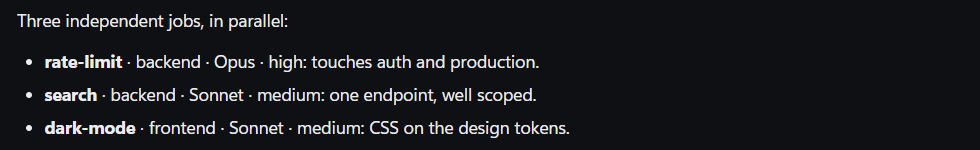

### A permanent team

In **Settings › Team**, give workers a post: backend, frontend, QA, DevOps, docs, or one of your own subagents. A post keeps its memory from one mission to the next, sleeps when idle (nothing runs) and wakes when the master writes to it. When its context fills up, it leaves itself a handoff note and starts fresh. You can ask the master to add or change a post.

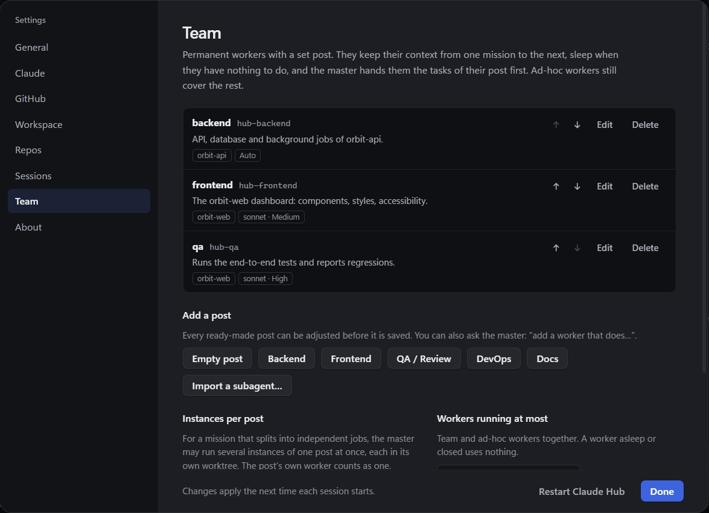

### Reinforcements

When a mission splits into independent jobs, the master can run several copies of one post at once, each in its own git worktree and branch, so they never step on each other.

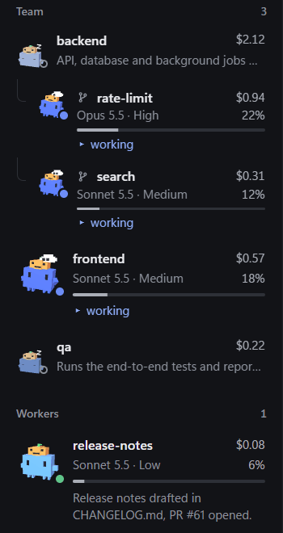

### Topics

With several jobs going, the master's conversation is filed by topic. A red badge marks where the master waits for your answer; reply right there. A finished topic goes with its cross, history and all; the master's own conversation stays.

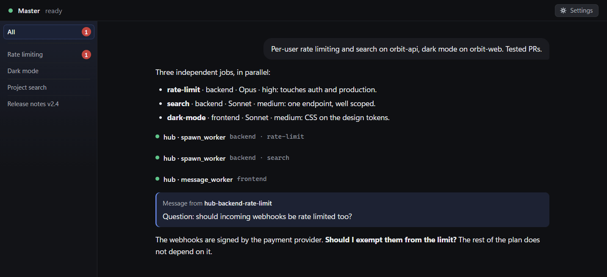

### Real Claude Code sessions

Every session is a plain Claude Code session: your `CLAUDE.md` files, plugins, MCP servers and models. Open any worker beside the master to watch it or talk to it directly.

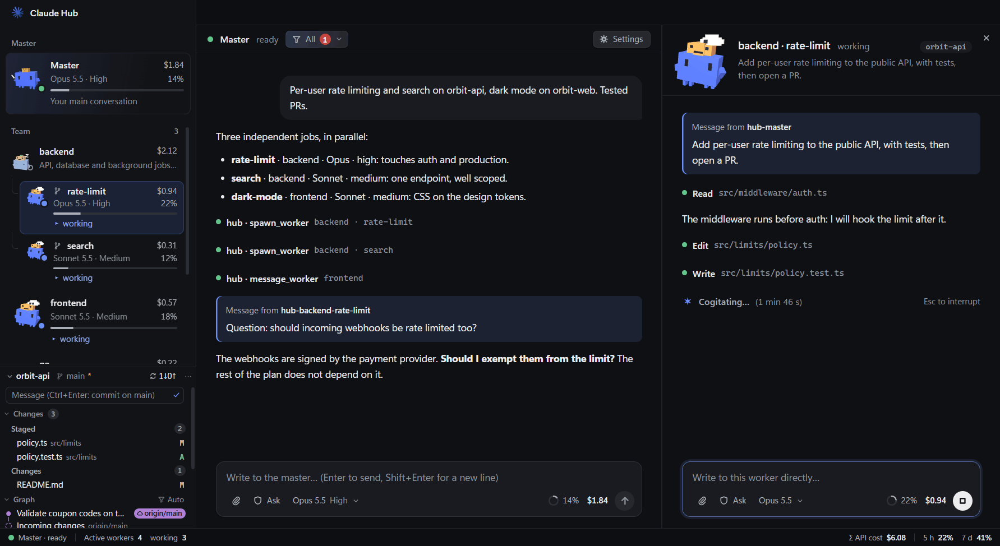

### Git and cost at hand

<table>
<tr>
<td width="50%" valign="top"><b>Git panel.</b> Branches, worktrees, changes and the graph of the repos you follow. Commit, pull and push without leaving AI Box.<br><br>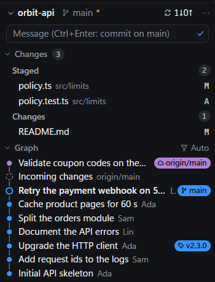</td>
<td width="50%" valign="top"><b>Cost.</b> Every card shows its cost and how full its context is. <b>Σ API cost</b> opens the spend by day, week or month, split by session.<br><br>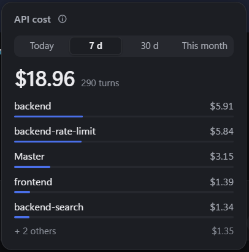</td>
</tr>
</table>

### "/" commands

In any composer: `/compact`, `/clear`, `/model`, `/effort`, `/mode`, `/cost`, then the session's own Claude Code commands and skills. The "/" button beside the model opens the same list.

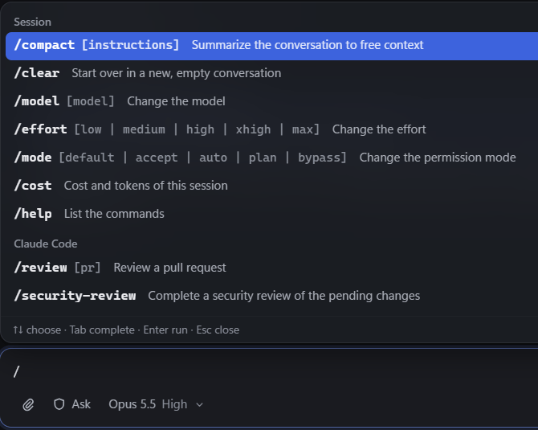

### A Clawd for every session

Each session gets an animated 3D Clawd that shows what it is doing: typing, searching, delegating, celebrating, sleeping.

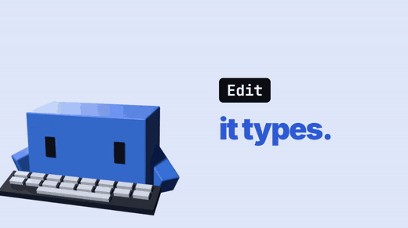

### And also

**Ctrl+K** (⌘K) for every command, Ctrl+1…9 to switch sessions. English and French. Light and dark themes. Idle and closed sessions resume with their whole conversation. A copy cloned from GitHub updates itself, never over your own changes. Light on your machine: the mascots and animations stop when nothing happens.

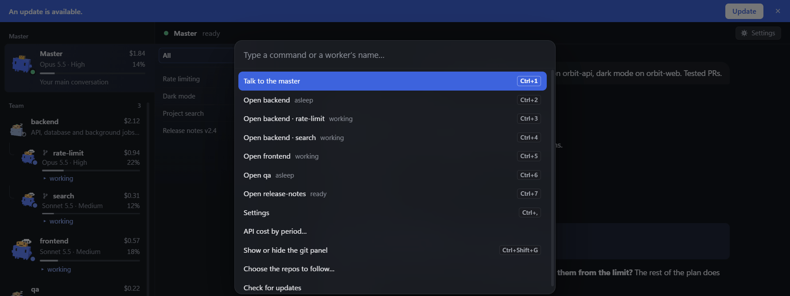

## Quick start

**You need:** Windows, macOS or Linux · [Node.js](https://nodejs.org) 22.12+ · [git](https://git-scm.com) (on a Mac: `xcode-select --install`) · a Claude subscription or an [Anthropic API key](https://console.anthropic.com/settings/keys). GitHub is optional.

```sh
git clone https://github.com/Anilito1/claude-hub.git
cd claude-hub
npm install
npm start
```

The first start downloads Electron (about 100 MB); Claude Code comes with the install. A short setup then asks for your language, your Claude access, GitHub (optional), the folders that hold your repos and the repos to follow. Everything stays editable in **Settings**.

**Signing in.** AI Box never asks for your Claude credentials. **Sign in with Claude Code** opens a terminal with Claude Code's own sign-in (`claude auth login`), as Anthropic's [rules](https://code.claude.com/docs/en/legal-and-compliance) require. Or paste an API key; it is stored encrypted by your OS keychain.

**Updates** are automatic: when a new version is on GitHub, a small badge beside **Settings** offers **Update**, and AI Box builds it, restarts and picks the sessions up where they were. It only updates a clean `main` that follows the official repo. A copy cloned **before 26 October 2026** needs one manual update (this drops local changes and local commits): close AI Box, then in its folder run `git fetch origin`, `git reset --hard origin/main`, `npm install`, `npm start`.

Running several sessions at once uses your plan or API budget faster: keep an eye on the cost and limits in the status bar.

## Before you start: safety

AI Box gives AI agents your computer.

- **Sessions act as you.** They read and change files and run commands, within the permission mode you choose. Anything they read can try to steer them (prompt injection).
- **A worker loads its repo's Claude Code setup** (`CLAUDE.md`, `.claude/settings.json` hooks, `.mcp.json`). Only send workers into repos you trust.
- **Leaving your folders needs your yes.** A worker that would work outside your folders and followed repos waits for you, whatever the mode.
- **"Allow everything" removes every approval**, including MCP confirmations before a `DROP` or `DELETE`. It is off unless you turn it on; use it only where you can afford to lose things.
- **No telemetry.** AI Box itself only talks to `api.anthropic.com` (to check a key), GitHub, and the git remotes you follow.

Found a vulnerability? Please open a private security advisory rather than a public issue.

## Development

```sh
npm run typecheck   # TypeScript
npm test            # unit tests
npm run build       # bundles into dist/
npm start -- --user-data-dir=<folder>   # run with a separate profile
```

`npm run dist` builds an installer for your platform (not signed, and not published: it would bundle Anthropic's Agent SDK, which is under [Anthropic's terms](https://code.claude.com/docs/en/legal-and-compliance)). A built app finds the Claude Code you install yourself. macOS is reviewed but not yet tested on a real Mac: reports are welcome.

## License

[MIT](LICENSE). Bundled third-party code (three.js, marked, DOMPurify, the commit graph from VS Code) is listed in [THIRD_PARTY_NOTICES.md](THIRD_PARTY_NOTICES.md). The Claude Agent SDK and Claude Code are Anthropic software under [Anthropic's terms](https://code.claude.com/docs/en/legal-and-compliance); they are installed from npm or by you, not shipped in this repository.
