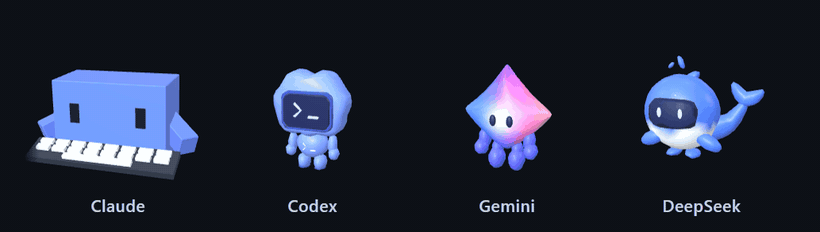
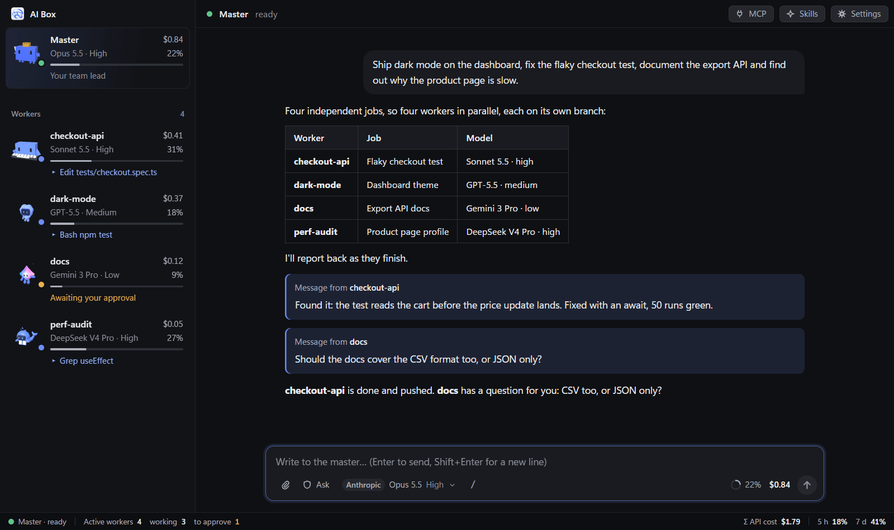

<p align="center"></p>

<h1 align="center">AI Box</h1>

<p align="center"><b>One chat. A whole team of AI coders, from any provider.</b><br>
Talk to one master agent: it splits the work, runs workers in parallel and reports back.</p>

<p align="center">
  
  
  <a href="LICENSE"></a>
</p>

<p align="center"></p>

<p align="center"></p>

## Why AI Box

| | |
|---|---|
| 👑 **A master that runs the show** | Say what you want. It writes a brief per job, starts the workers, answers their questions and sums up for you. |
| ⚡ **Workers in parallel** | Each one in its own repo, or its own git worktree and branch: they never step on each other. |
| 🔌 **Any provider, side by side** | Claude, Codex, Gemini and DeepSeek in the same team. Hit a limit? The work moves to your next account. |
| 🎯 **The right model for each job** | The master picks model and effort by difficulty, among the ones you allow. Cost and context are on every card. |
| 🧑‍🤝‍🧑 **A permanent team** | Backend, frontend, QA, docs, or your own posts: they keep their memory and sleep when idle. |
| 🗂️ **Topics** | The master's chat is filed by topic, with a badge where it waits for your answer. |
| 🧩 **MCP, Skills and one-click updates** | Manage MCP servers and skills from the app, update each provider's CLI in one click. AI Box rebuilds itself on start after an update. |

## A mascot for every agent

Every session gets its provider's 3D mascot, **Clawd**, **Codex**, **Gemini** or **DeepSeek**, that shows what it is doing: typing, searching, thinking, waiting for you, celebrating, sleeping, or knocked out by an error. The master wears a crown, and the team dresses up for Halloween, Christmas and New Year.

## Providers

| Provider | Runs on | Sign in |
|---|---|---|
| **Anthropic** | Claude Code | Claude account or API key |
| **OpenAI** | Codex | ChatGPT account or API key |
| **Google** | Gemini CLI | Google account or API key |
| **DeepSeek** | Claude Code | API key |

AI Box never sees your passwords: accounts sign in through each provider's own CLI, and API keys are stored encrypted by your OS.

## Quick start

You need [Node.js](https://nodejs.org) 22.12+ and [git](https://git-scm.com).

```sh
git clone https://github.com/Anilito1/claude-hub.git
cd claude-hub
npm install
npm start
```

A short setup asks for your language, your providers and the folders that hold your repos. Updates then arrive in one click.

> [!WARNING]
> Agents act as you: they read and change files and run commands, within the permission mode you choose. Only send them into repos you trust. AI Box has no telemetry.

## License

[MIT](LICENSE) · Third-party code: [THIRD_PARTY_NOTICES.md](THIRD_PARTY_NOTICES.md)

AI Box is an unofficial project, not made or endorsed by Anthropic, OpenAI, Google or DeepSeek. Their names, models and CLIs belong to them and run under their own terms; you install the CLIs and use your own access.
