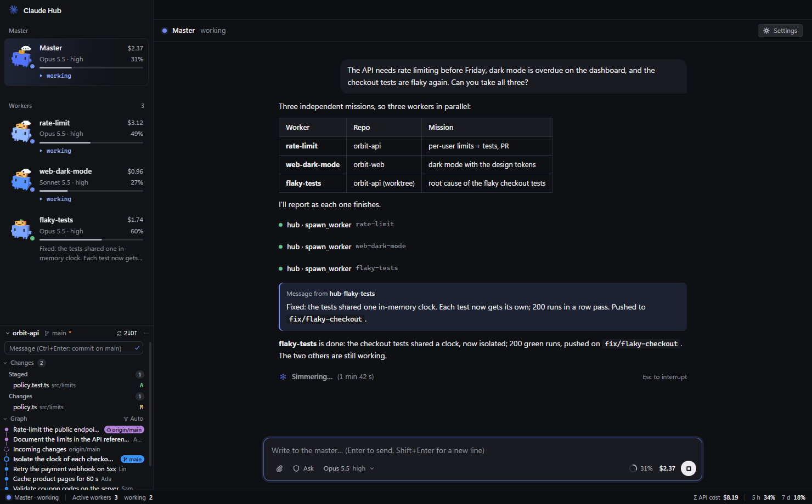
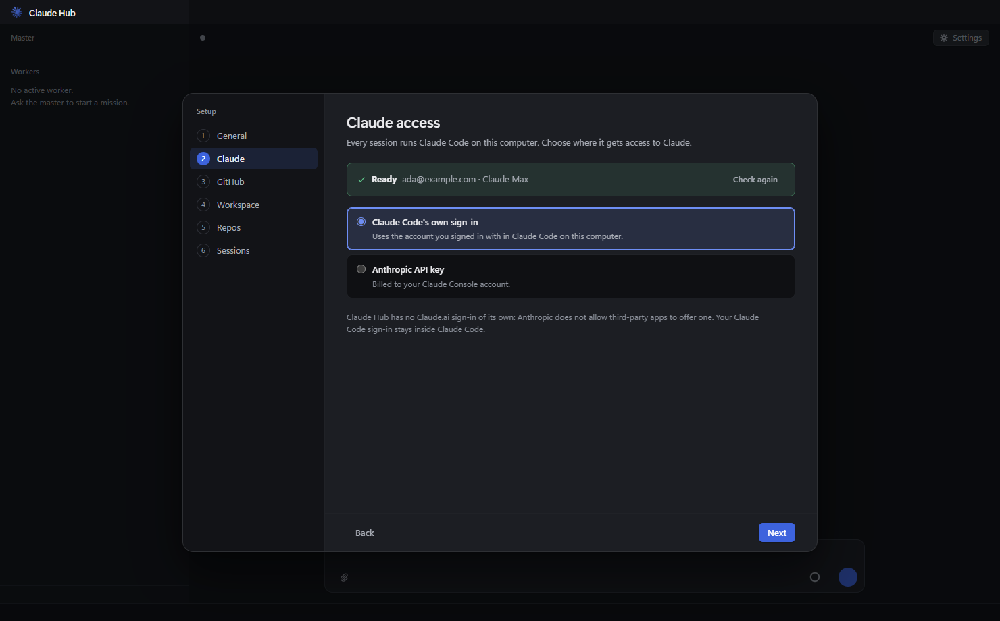

# Claude Hub

A desktop hub for [Claude Code](https://code.claude.com/docs): you talk to one **master** session, it splits the work and runs **worker** sessions for you, each in its own repository, and reports back.



> **Unofficial project.** Claude Hub is not made, endorsed or supported by Anthropic. Claude and Claude Code are trademarks of Anthropic PBC. Claude Hub runs the Claude Code you install yourself and uses your own Claude access.

## What it does

- **Master and workers.** The master is a Claude Code session with a few extra tools (`spawn_worker`, `message_worker`, `list_workers`, `worker_report`, `close_worker`, `list_repos`). It writes a self-contained brief for each mission and starts a worker in the right folder. Workers report to the master; the master summarizes for you. Independent missions run in parallel; workers that touch the same thing talk to each other.
- **A team of permanent workers.** In **Settings › Team**, give workers a post (backend, frontend, QA, DevOps, docs… from ready-made posts or your own `.claude/agents` subagents): a description that tells the master when to use it, standing instructions, working folders, a model and effort or "auto", a permission mode. The master hands a post the tasks of its scope first and starts ad-hoc workers for the rest. A permanent worker keeps its conversation from one mission to the next, sleeps when it has nothing to do (nothing runs), and wakes when the master writes to it. When its context is well filled, it writes a handoff note before falling asleep and its next mission starts a fresh conversation with that note. You can also ask the master to add or change a post (`list_roles`, `create_role`, `update_role`, `delete_role`); a deletion waits for your confirmation, and only you change a post's permission mode.
- **Model and effort per mission.** The master rates each task (ambiguity, scope, production risk, security, reasoning, duration) and picks the model and effort that are good enough at the lowest cost, among the models you allow (Opus and Sonnet by default) and up to the effort you allow. It says its choice in one line. A model or effort you set on a post, or pick by hand on a worker, always wins.
- **Every session is a real Claude Code session.** Same model, effort, `CLAUDE.md` files, plugins and MCP servers as when you run `claude` yourself. You can open any worker beside the master and write to it directly.
- **Live view.** Status, context use, cost, background tasks, permission requests, and an animated mascot per session that reacts to what the session is doing.
- **Git panel.** The repos you follow show their branches, worktrees, incoming and outgoing commits; pull, push and commit without leaving the hub. It checks their remotes in the background (`git fetch` every 60 seconds).
- **Closed sessions resume.** Idle ad-hoc workers close after 15 minutes, permanent ones fall asleep after 5; writing to one resumes it with its whole conversation. Work cut by a restart is picked up again.
- **English and French**, for the interface and for the instructions the sessions receive.
- **Keyboard and appearance.** Ctrl+K (⌘K on a Mac) opens the commands, Ctrl+1 to 9 switch between the master and the workers, Ctrl+, opens the settings, Ctrl+Shift+G folds the git panel. Light and dark follow the system.

## Requirements

- Windows 10/11, macOS or Linux (developed and tested on Windows 11).
- [Node.js](https://nodejs.org) 22.12 or later and [git](https://git-scm.com).
- Access to Claude, one of:
  - **Claude Code signed in** on this computer (run `claude` once and sign in), or
  - an **Anthropic API key** from the [Claude Console](https://console.anthropic.com/settings/keys).
- Optional: a GitHub account, and the [GitHub CLI](https://cli.github.com).

## Install and run from source

```sh
git clone https://github.com/<you>/claude-hub.git
cd claude-hub
npm install
npm start
```

`npm start` builds the app and opens it. On the first run Electron downloads its binary (about 100 MB). Running from source uses the Claude Code binary that npm installs with the Agent SDK.

### Build an installer yourself

This project is published **as source only**: no installer is released, and nothing in the repository publishes one (`"publish": null`). The reason: an installer bundles the Claude Agent SDK's JavaScript, which is Anthropic software under [Anthropic's terms](https://code.claude.com/docs/en/legal-and-compliance), not under this project's MIT license. Building one for yourself is fine:

```sh
npm run dist        # installer for the current platform, in release/
npm run dist:dir    # unpacked app only, quicker
```

Your builds are not code-signed: Windows SmartScreen and macOS Gatekeeper will warn. A built app does **not** contain Claude Code: install it yourself ([setup guide](https://code.claude.com/docs/en/setup)); the hub finds it on your `PATH` (on macOS and Linux, the `PATH` of your login shell, even when the app starts from the Finder or a launcher) or in `~/.local/bin`.

On macOS, closing the window keeps the hub and its sessions running (the Dock icon brings it back); **Cmd+Q** quits, and asks first if sessions are at work.

## First run

A short setup opens the first time, and every choice stays editable later in **Settings** (the gear at the top right of the master’s conversation):

1. **General**: language.
2. **Claude**: where the sessions get Claude from. The hub checks that Claude Code is installed and has access, and tells you what to do if not.
3. **GitHub** (optional): sign in so the git panel can fetch, pull and push without prompts.
4. **Workspace**: the folders that hold your repos. The master runs in the first one.
5. **Repos**: the repos the git panel follows and the master knows best. Your local repos and, once GitHub is connected, your GitHub repos, with search. Nothing is picked for you; a repo that is only on GitHub is cloned into your first working folder.
6. **Sessions**: permission mode, default models and effort, the models the master may pick for a mission, and your own instructions for the master (which repo a request is usually about, when to commit or deploy, how to report…).



## Claude access and Anthropic's rules

Claude Hub has **no Claude.ai sign-in of its own**, on purpose. Anthropic's [legal and compliance page](https://code.claude.com/docs/en/legal-and-compliance) states that third-party developers may not offer Claude.ai login in their own applications, nor collect, store or intermediate Claude.ai credentials; developers should use API keys or a cloud provider. It also says this does not prevent an end user from signing in to the unmodified Claude Code binary with their own subscription.

So the hub offers:

| Choice | What the hub does |
|---|---|
| **Claude Code's own sign-in** | Nothing: it runs Claude Code, which uses whatever you set up in it (`claude` → `/login`, Anthropic's own flow, or your environment). The hub never reads those credentials. |
| **Anthropic API key** | Checks the key with Anthropic, stores it encrypted, passes it to the sessions as `ANTHROPIC_API_KEY`. Billed to your Console account. |

Running several sessions at once uses your plan or your API budget faster: keep an eye on the cost and limits shown in the status bar.

## GitHub

Three ways to connect, all optional:

- **Sign in with GitHub** (OAuth device flow): you type a short code on github.com. It needs the Client ID of a GitHub OAuth App (see below). The token is stored encrypted.
- **GitHub CLI**: if `gh` is installed and signed in, the hub lets `gh` answer git's credential requests. No token is copied.
- **Personal access token**: fine-grained (Contents: read and write) or classic (`repo`).

The hub's own git commands get the sign-in through a credential helper set in their environment (`GIT_CONFIG_*`), never through your git config files. **Let the sessions use this account** (off by default) gives the sessions the same helper; with a token, they also receive it as `GH_TOKEN`, which a session can read. Left off, sessions use your own git setup (credential manager, `gh auth setup-git`, SSH keys).

### Creating the OAuth App (for the device flow)

If you build Claude Hub yourself, create your own OAuth App and paste its Client ID in **Settings › GitHub › Advanced** (or set `DEFAULT_CLIENT_ID` in `src/main/github.ts` for your builds):

1. GitHub › **Settings** › **Developer settings** › **OAuth Apps** › **New OAuth App** (or [github.com/settings/applications/new](https://github.com/settings/applications/new)).
2. **Application name**: anything (e.g. "Claude Hub"). **Homepage URL**: your repository URL. **Authorization callback URL**: required by the form but unused by the device flow; put your homepage URL.
3. Tick **Enable Device Flow**, then **Register application**.
4. Copy the **Client ID**. Do **not** create a client secret: the device flow does not use one.

The hub asks for the `repo`, `read:org` and `workflow` scopes (push to your repos, list organization repos, push workflow files).

## Where your data lives

| | Windows | macOS | Linux |
|---|---|---|---|
| Settings, state, secrets | `%APPDATA%\claude-hub` | `~/Library/Application Support/claude-hub` | `~/.config/claude-hub` |

- `config.json`: your settings (no secret). Settings of the first versions are migrated on the first start (your old file is kept as `config.legacy.json`, and a file already in the new format is never replaced by a migration); choose the repos to follow again in **Settings › Repos**.
- `secrets.json`: the API key and GitHub token, encrypted with the OS keychain through Electron [safeStorage](https://www.electronjs.org/docs/latest/api/safe-storage) (DPAPI, Keychain, libsecret/KWallet). On Linux without a keychain, the hub refuses to store secrets: set `ANTHROPIC_API_KEY` in your environment instead.
- `state.json` and `attachments/`: the session list and the images you paste (deleted after 30 days). Conversations themselves are Claude Code's own transcripts, in `~/.claude/projects`.

## Security

Claude Hub gives AI agents your computer. Read this before using it on anything that matters.

- **Sessions act as you.** Every session can read and change files and run commands with your account's rights, within the permission mode you chose. Content the sessions read (a README, a web page, an issue, another worker's message) can try to steer them: that is prompt injection, and no prompt is a security boundary.
- **A worker loads its repo's Claude Code configuration**, exactly like `claude` started in that folder: `CLAUDE.md`, `.claude/settings.json` (including hooks, which run commands) and `.mcp.json`. Only let workers into repos you trust, and read a repo you clone from someone else before starting a worker in it.
- **Permission modes.** The default is **Claude Code's own default** (auto mode where your account has it, otherwise it asks). **Ask** shows every approval in the conversation. Approvals and MCP confirmations of a worker appear in its conversation; the master cannot grant them for you.
- **⚠ "Allow everything" (bypass) removes every approval**: sessions run any command, commit, push, deploy or SQL, and MCP servers' confirmations (before a `DROP` or `DELETE`, for instance) are accepted automatically. Use it only on a machine, accounts and repos you can afford to lose, and keep backups. It is never on unless you turn it on, after an explicit confirmation.
- **The window is locked down**: sandboxed renderer with context isolation, strict Content-Security-Policy, sanitized Markdown, no navigation or pop-ups, and every message from the window to the hub is checked to come from its own page. Secrets never reach the window.
- **What leaves your computer**: the sessions talk to Anthropic like Claude Code does; the hub itself only calls `api.anthropic.com` (to check an API key), `github.com` and `api.github.com`, and runs `git fetch` on the repos you follow every 60 seconds. No telemetry.

Found a vulnerability? Please open a private security advisory on the repository rather than a public issue.

## Development

```sh
npm run typecheck   # TypeScript
npm run build       # bundles into dist/
npm start           # build + run
```

The code: `src/main` (Electron main process: sessions, hub tools, settings, GitHub, git), `src/preload` (the bridge the window uses), `src/renderer` (DOM, no framework), `src/shared` (types and i18n helpers). Strings live in `src/main/i18n.ts`, `src/renderer/i18n.ts` and the prompts in `src/main/prompts.ts`.

**Renaming the app** takes three places: `APP_NAME` (and `LOGO`) in `src/shared/brand.ts`, `build.productName` in `package.json`, and the images in `assets/` (`icon.ico`, `icon.png` at 512×512, `logo.png`). Keep `build.appId` and `APP_ID`: the settings folder and the Windows taskbar identity do not depend on the name. On macOS, the keychain entry that protects the stored secrets follows the app's name: after a rename, enter the API key and GitHub sign-in again.

## License

[MIT](LICENSE). The code the app bundles (three.js, marked, DOMPurify, and the commit graph ported from [Visual Studio Code](https://github.com/microsoft/vscode)) is listed with its licenses in [THIRD_PARTY_NOTICES.md](THIRD_PARTY_NOTICES.md) (`npm run notices` rewrites it). The Claude Agent SDK and Claude Code are Anthropic software under [Anthropic's terms](https://code.claude.com/docs/en/legal-and-compliance); they are installed from npm or by you, not shipped in this repository.
