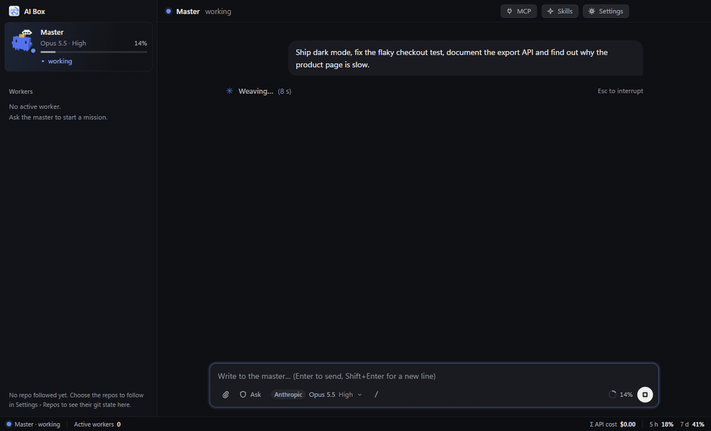
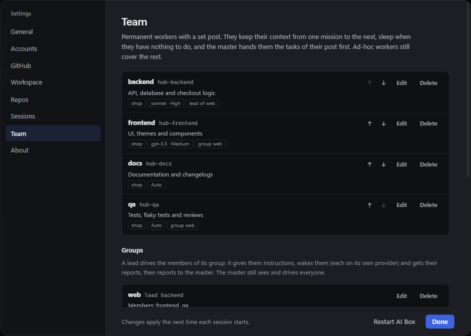
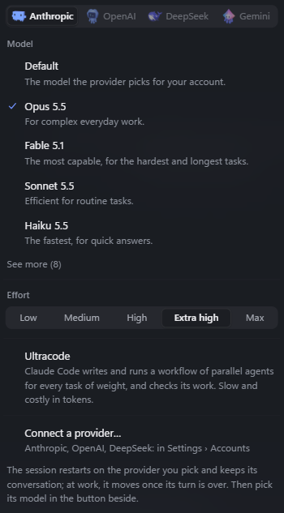
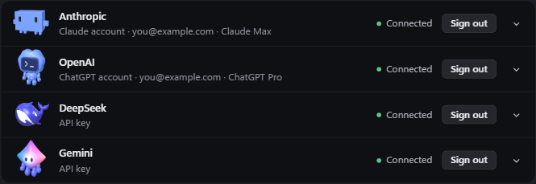

<p align="center"></p>

<h1 align="center">AI Box</h1>

<p align="center"><b>One chat. A whole team.</b><br>
You talk to one master. It delegates to workers that run in parallel, and reports back.</p>

<p align="center">
  
  
  <a href="LICENSE"></a>
</p>

<p align="center"></p>

## How it works

**1. You talk to the master, it runs the team.** Describe what you want. The master writes a brief per job, starts the workers, reads their reports, answers their questions and validates their work in your place. You are only called when it needs you.

**2. Permanent and one-off workers.** A *post* (backend, frontend, QA, docs, or your own) is a permanent worker: it keeps its memory from one mission to the next and sleeps when idle. One-off workers cover the rest. Posts can be put in a *group* under a lead that drives them and reports to the master.

**3. One post, several instances.** A mission that splits into independent jobs runs on several instances of the same post at once, each in its own git worktree and branch: they never step on each other.

<p align="center"></p>

**4. A chat filed by topic.** The master's conversation is split into topics, grouped by repo. A badge shows the ones where it is waiting for your answer.

**5. A master that stays light.** It orchestrates and produces nothing: it cannot edit files, only brief and route. The work, and its context, stays in the workers, so the master keeps its head across long days.

**6. The right model, the right effort.** For each mission the master picks the model and the effort from its difficulty, among the models you allow and up to the effort you cap. A choice you make on a post or on a worker always wins.

<p align="center"></p>

**7. Git, MCP and skills, built in.** A git panel per repo (graph, branches, commit, push) and automatic worktrees. Manage your MCP servers and skills from the **MCP** and **Skills** buttons, and update each provider's CLI in one click.

**8. A simple, consistent UI.** One window: the master, its team, its topics. Light and dark, English and French. Every session wears the mascot of its provider and shows what it is doing.

**Any provider, side by side.** Claude, Codex, Gemini and DeepSeek can work in the same team, on your accounts or API keys. Hit a limit? The work can move to your next account.

<p align="center"></p>

**Voice dictation (macOS 26+).** A microphone button in the composer, and a key to hold while you talk (Alt+Space by default). The words are recognised on your Mac by Apple's speech model: no audio leaves it, and it costs nothing. Nothing is sent until you press Enter. Language and key are in Settings › General. Building needs the Swift compiler (Xcode command line tools).

## What you get

More time. Everything in parallel. Peace of mind.

## Quick start

You need [Node.js](https://nodejs.org) 22.12+ and [git](https://git-scm.com).

```sh
git clone https://github.com/Anilito1/ai_box.git
cd ai_box
npm install
npm start
```

A short setup asks for your language, your providers and the folders that hold your repos. AI Box then updates itself in one click.

To build an installer: `npm run dist`. Before a merge: `npm run typecheck`, `npm test` and `npm run build` must be green.

## Updating

AI Box checks `Anilito1/ai_box` at start and every few hours. When `main` has something new, an **Update** button appears: one click fast-forwards your checkout, installs new dependencies, rebuilds and restarts the app, and puts the previous version back if anything fails. Nothing is touched if the checkout has local changes or is not the official repository.

> [!WARNING]
> Agents act as you: they read and change files and run commands, within the permission mode you choose. Only send them into repos you trust. AI Box has no telemetry, never sees your passwords (accounts sign in through each provider's own CLI) and stores API keys encrypted by your OS.

## License

[MIT](LICENSE) · Third-party code: [THIRD_PARTY_NOTICES.md](THIRD_PARTY_NOTICES.md)

AI Box is an unofficial project, not made or endorsed by Anthropic, OpenAI, Google or DeepSeek. Their names, models and CLIs belong to them and run under their own terms; you install the CLIs and use your own access.
