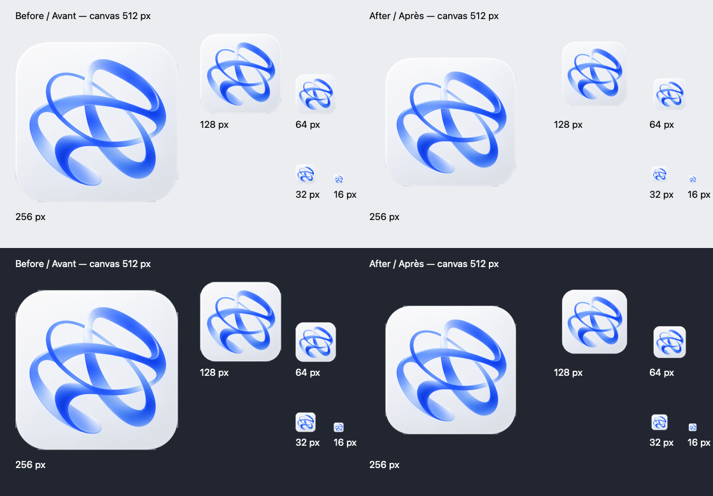

# macOS icon scale

The Dock/Finder hypothesis is supported by the asset measurements: the original
rounded-square tile reaches both sides of its 512 × 512 canvas. The sidebar uses
`assets/logo.png` separately. No installed app or user data was inspected.

## Comparison (2026-11-03)

Compare the **whole icon**, including its tile and transparent margins, at the
same canvas size. Width and height below use alpha ≥ 128/255, excluding faint
shadows. Alpha area sums alpha/255 over the canvas, so shape and visual weight
are considered as well as bounding boxes.

| Icon | Canvas | Visible bounds | Width / canvas | Alpha area / canvas |
| --- | --- | --- | --- | --- |
| AI Box before | 512² | 512 × 503 | 100% | 94.78% |
| AI Box after | 512² | 412 × 405 | 80.47% | 61.32% |
| Microsoft Code OSS | 512² | 412 × 412 | 80.47% | 62.25% |
| Electron | 512² | 439 × 439 | 85.74% | 57.73% |

The whole AI Box artwork is scaled to 412² inside the unchanged 512² canvas,
with a 50 px transparent inset. Linear scale decreases 19.53%; alpha area
decreases about 35.3%. The original artwork's slight vertical asymmetry remains.
No symbol, tile, color or corner has been redrawn. At 1024² these proportions
correspond to an 824 px artwork rectangle with 100 px margins.

[Apple's app icon guidance](https://developer.apple.com/design/human-interface-guidelines/app-icons)
describes a square 1024² layout, icon grids and checking small sizes;
[Apple Design Resources](https://developer.apple.com/design/resources/) supplies
the templates. Current guidance concerns system-masked/layered icons. This app
uses a traditional precomposed PNG/ICNS pipeline: **80.47% is an optical choice
based on the reference tile, not a percentage prescribed by current Apple HIG**.
The reference circle also demonstrates why equal bounding boxes alone do not
mean equal visual weight.

Public reference assets, decoded at 512² without cropping:

- [Microsoft Code OSS](https://github.com/microsoft/vscode/blob/main/resources/darwin/code.icns)
  (the open-source build icon, not the branded VS Code icon).
- [Electron](https://github.com/electron/electron/blob/main/shell/browser/resources/mac/electron.icns).

## Preview and regeneration

Run `swift scripts/macos-icon.swift` from the repository root on macOS to recreate
`assets/icon-macos.png` and this preview. This applies high-quality deterministic
resampling to `assets/icon.png`, the existing transparent bitmap master. The
larger original `assets/source/ai-box-logo.png` has a baked-in opaque background;
rescaling it would lose the existing cutout. There is no vector source in assets.

## Pipeline and verification

- `build.mjs` copies `assets/logo.png` to the renderer; it does not generate icons.
- Dock (source runs) and macOS BrowserWindow use `assets/icon-macos.png`.
- `scripts/macos-app.sh` uses that same PNG for every ICNS size (16–1024 px).
  Its wrapper stamp includes the icon hash so a future normal launch can refresh
  the Finder bundle as well. No installed bundle was refreshed during this work.
- electron-builder's macOS icon and packaged resource list use the same PNG.
- Windows ICO, Linux PNG, sidebar logo and original source are unchanged.

Both ICNS conversion paths were exercised in an isolated output directory:
the installer's `sips`/`iconutil` sequence and electron-builder's actual
`convertIcon` helper (no fallback). Decoding each produced the same 512 px alpha
bounds and area as the new PNG. The installer includes all ten standard iconset
entries; its 1024 px image remains an upscale of the existing 512 px artwork.
The preview checks small-size legibility without launching an installed app.

Validation: `npm run typecheck`, `npm run build`, `npm test` (417/417),
`git diff --check` and `sh -n scripts/macos-app.sh` passed. Regeneration is
byte-for-byte reproducible. Both decoded ICNS outputs match the PNG pixels
exactly at 512 px; all entries retain the expected centered inset (within
1.5 px for rounding at small sizes).
